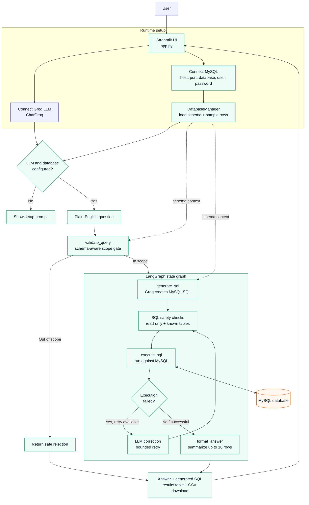

# Text to SQL

Natural-language querying for MySQL databases using a Streamlit interface, Groq-hosted language models, LangChain, and LangGraph.

Ask a question such as:

> Show the five customers with the highest credit limit

The application reads the connected database schema, generates a read-only MySQL query, executes it, and presents both a natural-language answer and the returned data.

## Features

- Streamlit web interface with sidebar connection setup.
- Groq LLM connection test before querying.
- MySQL connection with schema discovery.
- Schema-aware natural-language-to-SQL generation.
- Query validation that rejects greetings, unrelated questions, and requests outside the loaded schema.
- Read-only SQL guard allowing `SELECT`, `SHOW`, `DESCRIBE`, `DESC`, and `EXPLAIN`.
- Basic table-reference validation against the discovered schema.
- One automatic LLM-assisted correction attempt path for failed SQL execution, with bounded retries.
- Natural-language result summaries.
- Tabular result display in Streamlit.
- CSV download for query results.
- Optional terminal-style interactive mode in `agent.py`.

## How it works



The main workflow is implemented as a LangGraph state graph:

1. `generate_sql` creates a SQL query from the question and schema.
2. `execute_sql` validates and runs the query.
3. `format_answer` converts the returned rows into a concise response.

Before that graph runs, `validate_query` acts as an input gate. The database schema is loaded by `DatabaseManager.get_schema()`, including table names, columns, primary-key markers, and up to two sample rows per table.

### Request lifecycle

1. **Connect services:** The user provides a Groq API key and MySQL credentials in the Streamlit sidebar.
2. **Load context:** `DatabaseManager` discovers tables, columns, primary keys, and sample rows from MySQL.
3. **Filter the request:** `validate_query` uses the current schema to reject unrelated or unsupported questions.
4. **Generate SQL:** The `generate_sql` node asks Groq for a MySQL query using only the loaded schema.
5. **Protect execution:** The pipeline permits only read-oriented SQL and checks referenced tables against the discovered schema.
6. **Run and recover:** `execute_sql` queries MySQL. If execution fails, the workflow can ask the LLM for a corrected query within its retry limit.
7. **Present results:** `format_answer` summarizes the result, while Streamlit displays the answer, SQL, rows, and CSV export.

Solid arrows represent the main request path. Dashed arrows represent schema context supplied to validation and SQL generation. The diagram is rendered automatically by GitHub from the Mermaid block.

## Project structure

```text
Text_to_Sql/
├── agent.py        # Database manager, LLM pipeline, validation, and query execution
├── app.py          # Streamlit user interface
├── .env.example    # Environment-variable template
├── .gitignore      # Local environment and secret exclusions
└── README.md       # Project documentation
```

## Prerequisites

- Python 3.10 or newer
- A [Groq API key](https://console.groq.com/keys)
- A reachable MySQL 5.7+/8.x-compatible database
- Network access from the machine running Streamlit to both Groq and MySQL

The configured model is `openai/gpt-oss-20b` through Groq.

## Installation

### Windows PowerShell

```powershell
git clone <your-repository-url>
cd Text_to_Sql

python -m venv venv
.\venv\Scripts\Activate.ps1

python -m pip install --upgrade pip
python -m pip install streamlit mysql-connector-python langchain-groq langchain-core langgraph prettytable colorama python-dotenv
```

If PowerShell prevents activation, either allow local scripts for your user or run the commands using `venv\Scripts\python.exe` directly.

### macOS/Linux

```bash
git clone <your-repository-url>
cd Text_to_Sql

python3 -m venv venv
source venv/bin/activate

python -m pip install --upgrade pip
python -m pip install streamlit mysql-connector-python langchain-groq langchain-core langgraph prettytable colorama python-dotenv
```

## Configuration

The Streamlit app collects credentials at runtime:

1. Enter a Groq API key in the **Connection setup** sidebar and select **Connect LLM**.
2. Enter the MySQL host, port, database name, username, and password.
3. Select **Connect database**.
4. Review the displayed schema.

The default MySQL port in the UI is `3306`. Credentials are held in the running Streamlit session and are not written to the repository by the application.

`.env.example` is provided as a starting point for local environment configuration and programmatic use. The current Streamlit UI still requires entering the Groq and MySQL values in the sidebar; setting an environment variable alone does not populate those form fields.

Create a local `.env` only if you need it for your own integration:

```dotenv
GROQ_API_KEY=replace_with_your_key
DATABASE_URL=replace_with_your_database_url
```

Never commit `.env`, API keys, database passwords, or connection strings. The repository `.gitignore` excludes `.env` and the local virtual environment.

## Running the application

From the project directory with the virtual environment activated:

```powershell
streamlit run app.py
```

Then open the local URL printed by Streamlit, usually `http://localhost:8501`.

## Using the application

1. Connect the Groq LLM.
2. Connect a MySQL database with read access to the tables you want to query.
3. Enter a plain-English question about that database.
4. Select **Run query**.
5. Review:
   - The generated SQL query.
   - The natural-language answer.
   - The returned rows and row count.
6. Select **Download data as CSV** when tabular results are available.

Examples:

```text
List all available tables
Count the records in the orders table
Show the five most recent orders
Which customers have the highest credit limit?
```

Questions must be answerable using the tables and columns in the connected schema. General conversation, unrelated questions, and requests for unavailable tables are intentionally rejected.

## Optional Python usage

`agent.py` also exposes functions for embedding the pipeline in another Python program:

```python
import agent

agent.configure_runtime(
    groq_api_key="replace_with_your_groq_key",
    mysql_config={
        "host": "localhost",
        "port": 3306,
        "database": "your_database",
        "user": "your_user",
        "password": "your_password",
    },
)

result = agent.run_query("List the five most recent orders")
print(result["answer"])
```

For a terminal loop instead of Streamlit:

```python
import agent

agent.configure_runtime(
    groq_api_key="replace_with_your_groq_key",
    mysql_config={
        "host": "localhost",
        "port": 3306,
        "database": "your_database",
        "user": "your_user",
        "password": "your_password",
    },
)
agent.interactive_mode()
```

## Security and operational notes

- Use a dedicated MySQL user with the minimum permissions required, preferably read-only permissions.
- The application is designed to execute read-only SQL, but generated SQL should still be reviewed before using this with sensitive or production data.
- Schema text and up to two sample rows per table are sent to the configured LLM to generate SQL. Do not connect databases whose schema or sample data must not leave the database environment.
- Query results are also sent to the LLM for natural-language formatting, with at most the first ten rows included in that formatting prompt.
- The application does not implement authentication, authorization, rate limiting, audit logging, or multi-user session management.
- Avoid printing or committing API keys, passwords, database URLs, or query results containing sensitive data.
- Rotate any credential that has accidentally been exposed during local development.

## Troubleshooting

### LLM connection fails

- Confirm the Groq API key is valid and active.
- Confirm the machine has outbound network access.
- Confirm the configured Groq model is available for the account.

### MySQL connection fails

- Verify host, port, database, username, and password.
- Confirm MySQL accepts connections from the machine running Streamlit.
- Check firewall, TLS, and provider allow-list settings.
- Confirm the account can run `SHOW TABLES`, `DESCRIBE`, and read the required tables.

### A question is rejected

The validation layer only accepts requests answerable from the currently loaded schema. Confirm the required table and columns appear in the **Database schema** panel and use the exact available concepts in the question.

### SQL execution fails

The pipeline may ask the LLM to correct a failed query, but it does not guarantee that every natural-language request can be translated successfully. Check the displayed SQL, the MySQL error, and the schema before retrying with a more specific question.

## Development checks

Run a syntax check before submitting changes:

```powershell
python -m py_compile agent.py app.py
```

There are currently no automated tests in the repository. When adding features, tests should cover schema parsing, SQL safety validation, database error handling, and Streamlit-facing result formatting.

## Limitations

- MySQL is the only supported database backend.
- The SQL dialect is MySQL.
- The application depends on a live Groq API request and a live MySQL connection.
- Schema discovery is performed when the database is connected; changes made later may require reconnecting.
- Results are displayed in full in the Streamlit table, while only the first ten rows are used for LLM answer formatting.
- The current workflow is intentionally read-only and does not support inserts, updates, deletes, DDL, or stored procedures.


